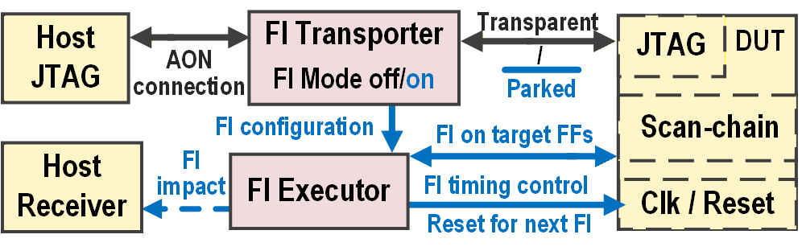

# FIawase

FIawase injects faults into a RISC-V SoC while its processor runs. It uses the SoC's
own scan chain to flip bits in its flip-flops, and it can run a whole campaign of
trials without the host stepping in. It works in gate-level simulation and on an
FPGA.



## How it works

An injection rotates the scan chain once. The chain is shifted `L` times, `L` being
its length, and the target bit is inverted as it passes the scan-out pin. After the
`L` shifts, each flop on the chain holds its old value again, except the target.
Blocks that should not change during the shift, such as memories, are kept off the
chain, and their clock is stopped for the same `L` cycles. The synthesis flow checks
that each flop is either on the chain or in a stopped block.

A campaign is a table that the host loads over JTAG. The wrapper then goes through
it by itself. For each entry it injects at the given cycle, lets the program run,
resets the SoC and moves to the next entry. The bits of one entry are flipped in
the same pass, so a multi-bit upset takes no longer than a single one.

## Repository

| | |
|---|---|
| `rtl/` | the wrapper. It is placed next to the DUT, not inside it. The DUT itself only gets the scan chain and a few freeze cells. |
| `syn/` | Design Compiler steps that add the scan chain and the freeze cells to the DUT, check the result and write the map from `FI_Index` to flop. `syn/flow/` is a small flow that runs them. |
| `sim/` | the simulation build, a testbench template, and the JTAG bridge OpenOCD connects to |
| `host/` | OpenOCD scripts that load and run campaigns |
| `fpga/` | tools and memory models for running on an FPGA |
| `tests/` | self-checking tests of the wrapper's timing. They need only Icarus Verilog, and GitHub runs them on every push. |
| `examples/tinyriscv/` | a complete example: the SoC, its configuration, testbench, workload and a Genesys2 build |
| `docs/` | runbook, porting guide and design reference |

The directories other than `examples/` are written to work with other DUTs. So far
they have been used with this one example. To use FIawase with another SoC, you
create a directory like `examples/tinyriscv/`.

## Running the example

The example needs Design Compiler, VCS, OpenOCD and a standard cell library of your
own. FIawase does not include any foundry data. The paths to your tools and
libraries go in `site.mk` at the top of the repository, which git ignores.

```sh
cp site.mk.example site.mk                # then fill it in
make -C syn/flow dc                       # the FI netlist
make -C examples/tinyriscv/sim            # the simulation
make -C examples/tinyriscv/sim openocd    # a second shell
telnet localhost 4444                     # a third
> poll off
> fi_campaign { {30000 {37}} {90000 {37 38 39}} }
```

Each trial is `{<cycle> {<FI_Index> ...}}`: the cycle to inject at, and the flops to
flip, given by their position in `fi_scanmap.txt`. [docs/RUNBOOK.md](docs/RUNBOOK.md)
goes through the steps. FIawase has been tested in gate-level simulation on this
example, with one PDK.

## Porting to your DUT

You write a configuration file that says which flops go on the chain and which
blocks are stopped, and a testbench based on `sim/fi_tb_template.sv`. On the first
run, the flow lists the registers that are not classified yet.
[docs/PORTING.md](docs/PORTING.md) describes the steps and what the SoC needs to
provide.

## On an FPGA

The scan-inserted netlist can also run on an FPGA. Its clock gates become clock
enables and the standard cells are rewritten as plain Verilog, so the scan chain and
`fi_scanmap.txt` can be used as they are. [fpga/README.md](fpga/README.md) describes
the conversion, and `examples/tinyriscv/fpga/` is the example on a Genesys2 board.

## Documentation

- [docs/RUNBOOK.md](docs/RUNBOOK.md) runs the example, from a clone to a campaign.
- [docs/PORTING.md](docs/PORTING.md) explains how to use FIawase with your own SoC.
- [syn/README.md](syn/README.md) describes the synthesis steps, settings and checks.
- [docs/DESIGN.md](docs/DESIGN.md) covers the architecture, register map and table
  encoding.

## Licence

FIawase is under the Apache License 2.0, except where a file says otherwise. The
example SoC is based on [tinyriscv](https://gitee.com/liangkangnan/tinyriscv). Two of
its files are under the Solderpad Hardware License 0.51. See [LICENSE](LICENSE) and
[NOTICE](NOTICE).
