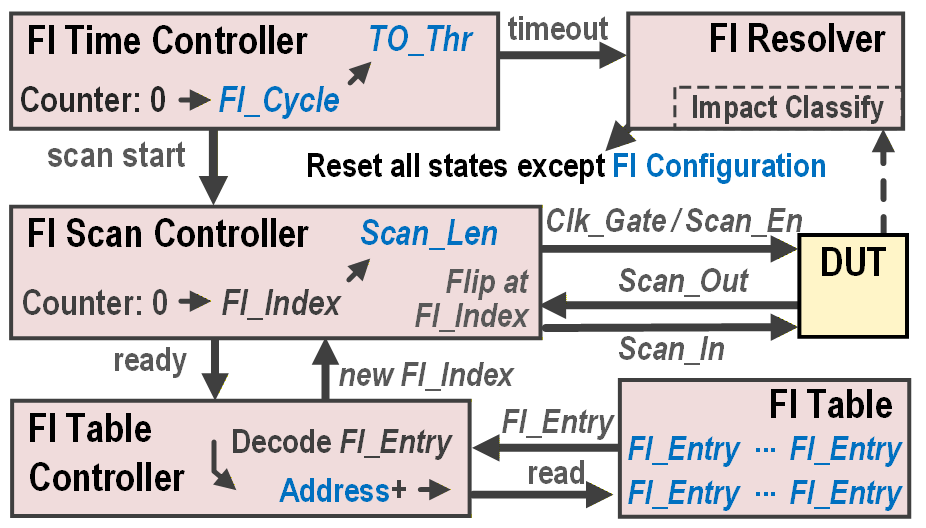
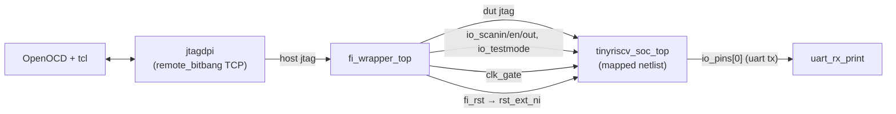
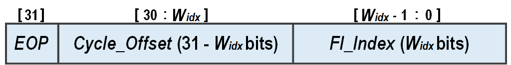

# Design

This page describes the architecture, the register map and the table encoding. What
a DUT needs to provide is described in [PORTING.md](PORTING.md).

---

## 0. Summary

The DUT (here a tinyriscv RV32IM SoC) is synthesised by a Design Compiler flow that
calls the FIawase steps. These add a clock freeze to the netlist and build one scan
chain (§2). The FI modules are RTL placed around that netlist. They run a loop that
reads an entry from the FI Table, injects, resets the DUT and reads the next entry,
until the table runs out. An entry can flip several bits. Blocks that are not on the
chain are frozen during the injection. The DUT's output is read across the freeze,
either by the wrapper's UART observer or, as in the example SoC, by a FIFO and a
clock-domain crossing inside the DUT (§6.2). The host loads the FI Table and the
configuration over JTAG/DMI, and the executor then runs by itself.

---

## 1. Overview

### 1.1 System level


- FI Mode off: Transparent. Host JTAG passes through to the DUT's JTAG.
- FI Mode on: Parked. The DUT's JTAG is parked and the Executor owns the DUT.
- Impact classification is done by external observation (§5.6).

### 1.2 Inside the Executor



| block | code | key signals |
|---|---|---|
| Host JTAG | tb `jtagdpi` + OpenOCD | `sim_jtag_tck/tms/tdi/tdo` |
| FI Transporter | [fi_transporter.v](../rtl/fi_transporter.v) | `fi_mode_active`, `cfg_*`, `tbl_host_*` |
| JTAG \| DUT | DUT `jtag_TCK/TMS/TDI/TDO_pin` | `dut_jtag_*` |
| FI Executor | [fi_executor.v](../rtl/fi_executor.v) | — |
| FI Time Controller | [fi_time_ctrl.v](../rtl/fi_time_ctrl.v) | `clock_counter`, `fi_cycle_q`, `scan_start`, `resolver_rst` |
| FI Scan Controller | [fi_scan_ctrl.v](../rtl/fi_scan_ctrl.v) | `run_cnt`, `hit_step_q/nx`, `entry_pop`, `scan_en_o`/`scan_in_o`/`clk_gate`, `done_o` |
| FI Table Controller | [fi_table_ctrl.v](../rtl/fi_table_ctrl.v) | `word_ptr`, `la_index/la_vld` (lookahead), `eop_fetched`, `cycle_offset_q`, `table_exhausted` |
| FI Resolver | the reset sequence inside fi_time_ctrl | `resolver_rst`, `testmode_rst` |
| FI Table | [fi_table.v](../rtl/fi_table.v) | `mem[]`, host port / exec port |
| Scan chain | inserted at synthesis | `io_scanin / io_scanen / io_scanout` |
| Clk / Reset | [fi_clk_gate.v](../syn/fi_clk_gate.v) + `fi_rst` | `fi_clk_gated`, `clk_gate`, `fi_rst` |
| Functional edges | [fi_wrapper_top.v](../rtl/fi_wrapper_top.v) | `run_o`: 1 on an edge the freeze lets through |
| Output window | [fi_wrapper_top.v](../rtl/fi_wrapper_top.v) | `trial_run_o`: 1 while a trial runs (§6.2) |
| Slow clock | [fi_slow_clk.v](../rtl/fi_slow_clk.v) | `slow_clk_o` (`SLOW_DIV`, §7) |
| UART observer | [fi_uart_obs.v](../rtl/fi_uart_obs.v) | reads a TX pin on `run_o` edges (§6.2) |
| Host receiver | [uart_rx_print.v](../examples/tinyriscv/tb/uart_rx_print.v) | `uart_rxd = io_pins[0]` |

---

## 2. Offline flow: RTL to netlist

A Design Compiler flow calls the FIawase steps of
[syn/fi_scan_lib.tcl](../syn/fi_scan_lib.tcl). [syn/README.md](../syn/README.md)
explains where they go in a flow of your own and what the checks cover. The example
flow, [syn/flow/](../syn/flow/), runs them in this order:

1. Read, elaborate, link, uniquify, apply the constraints. `fi_pre_compile` then edits
   the generic netlist: test-mode pins the RTL ties off are driven from `io_testmode`
   (or the port is created alone, `FI_TESTMODE_CREATE`),
   pins are tied for the FI build, memories without a `.db` become black boxes, latches
   that store data get a hold, registers off the chain without a reset get a clear, and
   exempt blocks are kept free of compile-inserted clock gates.
2. `compile_ultra -no_seq_output_inversion -no_autoungroup`, with `-gate_clock` if the
   port sets `FI_GATE_CLOCK`. `-no_autoungroup` keeps the instances the port names.
3. `fi_restore_clears` brings the DUT reset into the clears it does not hold, on registers
   off the chain. `fi_insert_clock_gate` / `fi_apply_scan_exclusion` insert the freeze and exclude the
   frozen blocks from the chain (§6.1). The block list is in the port's
   `fi_scan_cfg.tcl`, for the example
   [examples/tinyriscv/port/fi_scan_cfg.tcl](../examples/tinyriscv/port/fi_scan_cfg.tcl).
4. `compile_ultra -scan`, then `fi_dft_config`. It sets ScanClock to the functional
   clock only, Reset to the async reset, TestMode to `io_testmode`, one chain and no
   clock AutoFix. It also adds `io_scanin / io_scanen / io_scanout` and binds them to
   ScanDataIn / ScanEnable / ScanDataOut.
5. `create_test_protocol`, `insert_dft`, the example's DFT reports, `optimize_netlist`.
6. `fi_check_invariants` (A1–A12) on that final netlist. Then `change_names`, the
   output files, `fi_export_scanmap` (chain length and order, from
   `report_scan_path`) and `fi_export_clock_gates`.

Do not flatten the instances the port names. The hierarchy keeps scan cell order stable
and lets the testbench reach internal state by name.

Besides its functional ports, the netlist then has the functional clock and reset,
`io_testmode` (the DUT's own, or added by the flow for `FI_TESTMODE_PIN` or
`FI_TESTMODE_CREATE`), the freeze input named by `FI_GATE_PORT` (added if missing), and
`io_scanin, io_scanen, io_scanout`. In the example SoC these are `clk_50m_i,
rst_ext_ni, io_testmode, scan_gate, io_scanin, io_scanen, io_scanout`.

---

## 3. Simulation integration

The example's testbench is [chaos_soc_tb.sv](../examples/tinyriscv/tb/chaos_soc_tb.sv).
For a new DUT, start from [sim/fi_tb_template.sv](../sim/fi_tb_template.sv). The build,
[sim/fi_sim.mk](../sim/fi_sim.mk), includes the `fi_scan_cfg.vh` that synthesis wrote
next to the netlist.



- The DUT is the synthesised netlist, not the RTL. The netlist is not distributed here.
- Clocks: `aon_hfclk_i = clk_i` (50 MHz, `always #10`). For `aon_lfclk_i` see §7.
- Reset: `fi_rst = aon_rst_ni & ~resolver_rst_w`
  ([fi_wrapper_top.v](../rtl/fi_wrapper_top.v)), wired to `rst_ext_ni`.
- Firmware: `$readmemh` into ROM. The path comes from `+firmware=<file>`.
- Host JTAG: `jtagdpi` runs a remote_bitbang TCP server for OpenOCD.

---

## 4. FI Transporter

File: [fi_transporter.v](../rtl/fi_transporter.v).

```
TAP (fi_jtag_tap) → DTM (fi_jtag_dtm_v6)
                     → 2-phase CDC (fi_cdc_2phase_v6, tck ↔ aon)
                     → DMI registers (fi_dmi_regs_v6)
```

### 4.1 Two modes

| mode | `fi_mode_active` | DUT JTAG | host TDO comes from | used for |
|---|---|---|---|---|
| Transparent | 0 | passed through (`dut_jtag_* = jtag_*`) | the DUT's TDO | debugging the DUT normally |
| Parked | 1 | cut off (`tck=0`, `tms=1`, `tdi=0`) | the Transporter's own TAP | the Executor owns the DUT, FI runs |

A DMI write to `FI_MODE` with `data[0]=1` switches to Parked at a safe TAP boundary
(RTI/TLR with the DTM idle). Once parked, the host talks to the Transporter's TAP
(IDCODE `0xF17E_0007`) and can access the private FI registers.

### 4.2 Private FI DMI registers (base `0x60`)

| address | name | R/W | meaning |
|---|---|---|---|
| `0x60` | FI_MODE | RW | bit0: 1 = Parked/FI, 0 = Transparent |
| `0x61` | FI_STATUS | R | bit0 `cfg_en_able` (auto loop running). bit1 table finished. bit2 entries out of order. bit3 table ended without EOP. bit4 FI_Cycle passed the timeout. bit5 a DUT memory could not be restored and the campaign stopped (§5.1). bit6 the last trial was ended because a memory's undo log was full, count it as DUE (§5.1). |
| `0x62` | CFG0 | RW | bit0 = AUTO, bit1 = END |
| `0x63` | CFG_SCAN_LEN | RW | scan chain length L. A runtime value, unrelated to the table encoding |
| `0x64` | CFG_FI_INDEX | RW | static injection index, when not in auto mode. 0 turns that path off, so it cannot reach FI_Index 0 |
| `0x65` | CFG_FI_CYCLE | RW | base cycle at which to inject. Writing it reloads the running register `fi_cycle_q` (`counter == fi_cycle_q` → inject) |
| `0x66` | CFG_TO_THR | RW | timeout / reset cycle (`counter >= this` → reset) |
| `0x67` | FI_CMD | W | bit0 = start pulse (not needed in auto mode) |
| `0x68` | CFG_TBL_LEN | RW | number of FI_Entry words in this batch. Resets to 0, which injects nothing |
| `0x69` | FI_CYCLE | R | the live `fi_cycle_q`, advanced by `Cycle_Offset` each trial |
| `0x6F` | FI_VERSION | R | table format. `0x0003_0000` = EOP/Cycle_Offset, FI_Index 0 = first cell after Scan_In |
| `0x70` | TBL_CTRL | RW | bit0 = AUTOINC (pointer advances after each WDATA write) |
| `0x71` | TBL_ADDR | RW | table write pointer |
| `0x72` | TBL_WDATA | W | write one word (implicit write strobe) |
| `0x73` | TBL_RCMD | W | issue a read |
| `0x74` | TBL_RDATA | R | read data. The low 2 bits are the response (valid = OK, not ready = BUSY). |
| `0x75` | TBL_STATUS | R | bit0 autoinc, bit1 pending, bit2 valid |

### 4.3 Host configuration sequence

See [host/inject_and_run_dmi.tcl](../host/inject_and_run_dmi.tcl):

1. `FI_MODE = 1` (`0x60 ← 1`).
2. Load the table: `TBL_CTRL.AUTOINC = 1` (`0x70 ← 1`), `TBL_ADDR = 0` (`0x71 ← 0`),
   then write each word to `TBL_WDATA` (`0x72`). The helper
   `fi_pattern <offset> {<FI_Index list>}` emits one pattern and sorts its entries into
   descending `FI_Index`.
3. Configure: `CFG0 = AUTO` (`0x62`), `CFG_SCAN_LEN` (`0x63`), `CFG_FI_INDEX = 0`
   (`0x64`), `CFG_TBL_LEN = <entry count>` (`0x68`), `CFG_FI_CYCLE` (`0x65`),
   `CFG_TO_THR` (`0x66`).
4. Auto mode needs no explicit start.

Write order: `CFG_TO_THR` last, because it arms the loop. `CFG_TBL_LEN` and
`CFG_FI_CYCLE` before it. If `0x68` is not written, nothing is injected.

The low-level DMI write is `fi_dmi_write` in [host/tapename.tcl](../host/tapename.tcl):
`irscan 0x11` (the DMI IR) then `drscan {op=WRITE(2'b10), data[31:0], addr[6:0]}`.

---

## 5. FI Executor

[fi_executor.v](../rtl/fi_executor.v) = `fi_executor_core` (three sub-controllers)
plus `fi_table`. Glue: [fi_executor_core.v](../rtl/fi_executor_core.v).

### 5.1 FI Time Controller ([fi_time_ctrl.v](../rtl/fi_time_ctrl.v))

- `clock_counter` free-runs, +1 per cycle while not stopped.
- `counter == fi_cycle_q` raises `scan_start` and sets `fi_fired_q`. One injection per
  trial.
- `fi_cycle_q` loads its base value from `0x65`, then advances by `Cycle_Offset` at the
  end of each reset window, atomically with `clock_counter <= 0`.
- `counter >= cfg_to_thr`, a rising edge on `cfg_end`, or a memory asking to end the
  trial (UNDO below) enters the reset window (§7).
- With `SCRUB = 1` (the default), the window starts with a scrub pass. The Scan
  Controller shifts zeros into the chain while the DUT is still out of reset and frozen
  by `Clk_Gate`, as in any pass. `resolver_rst` rises on the last shift edge, so no
  functional edge comes in between. Each scan flop then starts the next trial as it
  would after power-on, with its reset value, or with 0 if it has no reset (for example
  a register file). If the chain were shifted with the DUT in reset instead, a flop
  held by an asynchronous set would push 1s into the flops without a reset that follow
  it on the chain. Without the scrub, those flops would keep what the previous trial
  left in them. Synthesis places the cells that the DUT reset does not restore at the
  start of the chain (§6.1), so the scrub only needs to shift those. `SCRUB_LEN` is
  this number, K, taken from `FI_SCRUB_LEN` in the generated `fi_scan_cfg.vh` (the
  whole chain, `L`, if it is not defined). The cells after them receive shifted values,
  and the reset restores them. `resolver_rst` is then held for two pacing intervals
  (§7), while `testmode_rst` keeps testmode low. With `SCRUB = 0`, the window waits one
  pacing interval and then holds `resolver_rst` for another one.
- The same reset also restores the registers off the chain. The synthesis flow added a
  clear driven by it to each such register that had no reset, and connected it to the
  clears it did not control (`FI_CLEAR`, §6.1).
- With `MEM_RESTORE = 1` (the default), the FI memory models return each DUT memory to
  its power-on content (`fi_mem_req_o`, answered by the AND of their `fi_done_o` on
  `fi_mem_done_i`). Memories are neither reset nor on the chain. Without the restore, a
  stray store in one trial, for example into the program memory, would remain in all
  later trials, and an uninitialised read would see the previous trial's data instead
  of the power-on value. With the scrub, the restore starts with its first shift. The
  freeze then holds the clock of each memory, so the DUT cannot access them, and the
  models restore them on the free-running clock. If the restore takes longer than the
  scrub, it continues while the DUT is in reset. `fi_mem_req_o` stays high until the
  reset is released, and the release waits for the memories. Without the scrub, the
  restore runs while the DUT is in reset.
  [fi_sram_restore.vh](../rtl/fi_sram_restore.vh), included in each memory macro's
  model, does it one of two ways:
  - UNDO, for a memory that a normal run does not write, such as program memory. Each
    write that changes a word pushes (address, old word) onto a small undo log, and the
    restore writes the old words back, newest first. A write that leaves the word
    unchanged is not logged. No copy of the content is kept, and a normal trial leaves
    the log empty. When the log is full, a further changing write is dropped, so the log
    stays complete, and the trial is ended like a timeout (FI_STATUS bit 6). The host
    counts such a trial as DUE, since a program that changes its program memory that
    often has run away.
  - FILL, for a memory that is written all the time and whose power-on content is the
    same word everywhere, such as a data memory starting at 0. The restore writes that
    word into every location, one row per bank (BRAM) per cycle, in `depth / banks`
    cycles. Nothing is recorded.

  A DUT write during the restore (`fi_bad_o`, OR'ed onto `fi_mem_bad_i`) means the DUT was
  not kept away from the memory, so the restore is not reliable. The window then stops
  with the DUT held in reset and sets FI_STATUS bit 5.
- `fi_cycle_q >= cfg_to_thr` raises `fi_cycle_ovf` and the batch stops.

### 5.2 FI Scan Controller ([fi_scan_ctrl.v](../rtl/fi_scan_ctrl.v))

- On a start (`scan_start` or `cfg_start`) with an entry ready, `clk_gate` goes high.
  One cycle later `scan_en` and `testmode` go high, and `run_cnt` counts from 0 to
  `L-1`, where `L = cfg_scan_len`. A start without an entry ready does nothing.
- `testmode` rises together with `scan_en`. After an injection pass it falls half a
  cycle after `scan_en`, on the falling clock edge. No functional edge sees it then,
  neither the last one before the pass, which captures the state to inject, nor the
  first ones after it. The half cycle is for the test-mode muxes in front of
  asynchronous sets and resets. On the last shift edge the chain takes its restored
  values, and a mux that switched on that same edge, while its functional input is
  still changing, could pass a glitch to the pin. On the falling edge, only testmode
  changes. After a scrub, testmode falls together with `scan_en`. A DUT may also use
  testmode for other purposes, for example a core that blocks its data-memory requests
  with it. `TM_LEAD` / `TM_TAIL_CYCLES` widen the window for a DUT that needs this and
  does not use testmode during normal operation.
- Datapath: `scan_in = (run_cnt == hit_step_q) ? ~scan_out : scan_out`.
- `hit_step = (FI_Index >= L) ? L : (L - 1 - FI_Index)`. `FI_Index` 0 is the first cell
  after Scan_In. `L` means no flip.
- Several flips per pass. Minimum spacing between two targets is 1.
- An out-of-order entry (`run_cnt > hit_step_q`) is dropped and sets `err_order`. A
  null entry (`hit_step > L-1`) retires immediately.
- At the end of the pass `done` pulses and `scan_en`, `testmode` and `clk_gate` drop.
- A scrub pass (from the reset window) runs the same way with `scan_in = 0` for
  min(`SCRUB_LEN`, L) shifts (none for 0), flips and pops nothing, and ends with
  `scrub_done` instead of `done`.

### 5.3 FI Table Controller ([fi_table_ctrl.v](../rtl/fi_table_ctrl.v))

- Fill window: `[falling edge of resolver_rst, EOP entry fetched or
  word_ptr == Table_Len]`, one word per cycle into a `LOOKAHEAD = 4` shift register.
  When `|F| > LOOKAHEAD` it refills while consuming, at the same rate.
- Fetching an entry with `EOP = 1` latches `cycle_offset_q` and stops the fill, leaving
  the pointer on the first entry of the next pattern.
- The end of the table is counted, not sentinelled (`word_ptr` vs `Table_Len`).
- `resolver_rst` preserves `word_ptr`, `cycle_offset_q`, `table_exhausted`,
  `err_malformed`.
- A write to `CFG_FI_CYCLE` starts a new batch: `word_ptr` goes back to word 0 and
  `table_exhausted`, `err_malformed` and `cycle_offset_q` clear. The host writes it when it
  arms every campaign, so campaigns follow each other without a reset of the wrapper.

### 5.4 FI Table ([fi_table.v](../rtl/fi_table.v))

- 256 words x 32 bits, without an SRAM macro, so the table needs no library. An FPGA
  maps it to distributed RAM.
- A host port written by the Transporter, whole words. A combinational exec read port,
  `exec_rdata = mem[exec_rd_addr[.. :2]]`, byte address / 4.
- The content has no reset. It starts as 0 and keeps what the host wrote. An all-zero
  word is a valid entry. The end of the table is given by `CFG_TBL_LEN`, so words after
  it are not read.

### 5.5 FI Table encoding (EOP + Cycle_Offset)



`W_IDX = $clog2(N_FF)`, and `N_FF` comes from `fi_scan_cfg.vh`. With `N_FF = 8192`,
`W_IDX = 13` and `Cycle_Offset` is 18 bits wide.

| field | valid when | meaning |
|---|---|---|
| `EOP` | always | 1 = this is the last entry of the current replay pattern |
| `Cycle_Offset` | only when EOP = 1 | non-negative increment added to `FI_Cycle` after this pattern's trial. Patterns that stay on the same cycle write 0 |
| `FI_Index` | always | scan position, 0 = first cell after Scan_In (`hit_step = L-1-FI_Index`). `FI_Index >= L` flips nothing. |

- One pattern = one pass of L cycles. All of its entries are consumed inside that pass,
  so an `|F|`-bit MBU freezes the DUT for `L` cycles, not `|F| × L`.
- Within a pattern `FI_Index` must descend, so `hit_step` ascends. A spacing of 1 is
  legal. `fi_pattern` sorts for you.
- `N_FF` is an encoding bound, not the current chain length, and is a power of two. The
  contract is `L ≤ 2^W_IDX − 1`, asserted at synthesis (A4).
- End of table: `word_ptr == CFG_TBL_LEN`. If the last entry has `EOP = 0` the table is
  malformed. The hardware closes the pattern with an implicit EOP and sets
  `err_malformed`.

Example: six patterns in nine entries (`CFG_TBL_LEN = 9`), all offsets zero.

| word | hex | EOP | offset | FI_Index | pattern |
|---|---|---|---|---|---|
| 0 | `0x80000244` | 1 | 0 | 580 | P0, single bit |
| 1 | `0x00000270` | 0 | — | 624 | P1, 3-bit MBU, FI_Index descending |
| 2 | `0x00000269` | 0 | — | 617 | P1 |
| 3 | `0x80000268` | 1 | 0 | 616 | P1, last |
| 4 | `0x80000294` | 1 | 0 | 660 | P2 |
| 5 | `0x800002D2` | 1 | 0 | 722 | P3 |
| 6 | `0x000006C0` | 0 | — | 1728 | P4, 2-bit MBU |
| 7 | `0x800006BA` | 1 | 0 | 1722 | P4, last |
| 8 | `0x80000521` | 1 | 0 | 1313 | P5 |

### 5.6 FI Resolver and the auto loop

- `resolver_rst` resets the DUT (via `fi_rst`) and the executor's internal state. It
  preserves the FI configuration and the table pointer.
- Impact classification is not implemented in RTL. Impact is observed externally: the
  UART (`uart_rx_print`), the tb's `inst_valid` counters, and `sim_end`.
- Auto-loop enable ([fi_executor_core.v](../rtl/fi_executor_core.v)): with
  `cfg_auto = 1`, `cfg_en_able` is set on every rising edge of `resolver_rst` and
  cleared by `table_exhausted` or `fi_cycle_ovf`. The clear ranks above the set.
- In auto mode the entry stream comes from the Table Controller. Otherwise a single
  synthetic entry is built from `cfg_fi_index`.

### 5.7 One FI iteration (auto mode)

```mermaid
sequenceDiagram
  participant T as Time Ctrl
  participant S as Scan Ctrl
  participant B as Table Ctrl
  participant D as DUT
  Note over D: reset released, program runs from the start
  Note over B: resolver_rst falls → prefill lookahead, stop at EOP, latch Cycle_Offset
  T->>T: counter++ until == fi_cycle_q
  T->>S: scan_start (and set the fi_fired latch)
  S->>B: pop entries one by one
  S->>D: clk_gate=1 (freeze off-chain blocks) + one pass of L cycles,<br/>flipping once at each of the |F| hit_step values
  Note over D: |F|-bit pattern injected, clk_gate=0, DUT keeps running
  T->>T: counter continues to >= CFG_TO_THR
  T->>D: resolver_rst → fi_rst resets the DUT
  Note over B: internal state cleared, word_ptr / cycle_offset kept → next pattern
  Note over T,D: counter cleared and fi_cycle_q += Cycle_Offset in the same cycle;<br/>loop stops after the done of the pass where word_ptr == TBL_LEN
```

---

## 6. Freezing, and reading the output across a freeze

### 6.1 Freezing the off-chain blocks

What gets frozen is declared in the port's `fi_scan_cfg.tcl`, by instance (`FI_FREEZE`)
or by clock pin (`FI_GATE_PINS`). The example SoC's
([examples/tinyriscv/port/fi_scan_cfg.tcl](../examples/tinyriscv/port/fi_scan_cfg.tcl)):

```tcl
set FI_GATE_PINS { u_rom/clk_i u_ram/clk_i u_jtag/clk_i uart0/clk_i
                   spi0/clk_i xip/clk_i bootrom/clk_i u_pinmux/clk_i ... }
set FI_EXEMPT        { u_rst uart0 }
set FI_EXEMPT_CLOCKS { jtag_TCK }
```

On the mapped design, [fi_scan_lib.tcl](../syn/fi_scan_lib.tcl) compiles
[fi_clk_gate.v](../syn/fi_clk_gate.v) into the netlist: one synchroniser and gate,
`u_fi_clk_gate`, on the free-running clock. A frozen pin driven straight by that clock is
re-routed onto the gate's output, `fi_clk_gated`. A frozen pin behind a clock gate of the
DUT, written in RTL or inserted by compile (`FI_GATE_CLOCK`), gets an `fi_clk_freeze` cell
in series in front of it, fed with the gate's `freeze` term, so the DUT's gate keeps
working: an edge passes iff the DUT's gate passes it and `freeze` is low at it. The owning
instances get `set_scan_element false`.

Two more cells keep the off-chain state consistent. Both are spliced in on the generic
netlist, before the first compile:

- `fi_latch_hold`, in front of the enable of every latch that stores data, holds it
  closed while `freeze` is high. A clock freeze does not stop such a latch, and its
  enable follows the scrambled logic while the chain shifts.
- `fi_clear`, from the DUT reset, clears every register off the chain that has no reset
  of its own, so nothing a trial leaves in it reaches the next trial (§5.1).

On the mapped design, `fi_restore_clears` does the same for a register off the chain whose
clear the DUT reset does not hold, such as one written `rst_ni || x`: the reset is AND-ed
into an active-low clear (OR-ed, inverted, into an active-high one). A register with a
preset, or a pin of unknown polarity, stops the run unless the port lists it in
`FI_RESET_ACK` with a reason.

On the chain, the registers that the DUT reset does not restore come first, next to
Scan_In (`FI_CHAIN_HEAD_NORESET`, set by `fi_dft_config` before `insert_dft`). The scrub
at the end of a trial then shifts only those K cells (§5.1), and A12 checks that they
are the first K.

The checks A1–A12 then examine the final netlist
([syn/README.md](../syn/README.md#the-checks)). For example, A2 checks that no flop is
both on the chain and frozen.

```
gate_q  = FF(clk_gate)                 // exactly one stage
freeze  = gate_q & clk_gate            // engage late, release early
clk_o   = clk & latch_neg(~freeze)      // latch + AND, full-width pulses
```

The edge count is worked out at the top of [fi_scan_ctrl.v](../rtl/fi_scan_ctrl.v).
The chain takes L extra shift edges, so the off-chain blocks have to lose exactly L
functional edges. The enable therefore engages on the registered request and releases
on the raw one, `~(gate_q & clk_gate)`. A plain `clk & ~gate_q` removes the same edges
but leaves a runt pulse at the start of the window, and an ICG enabled by `~gate_q`
alone removes one edge too many. Three things have to stay as they are:

- There is exactly one synchroniser flop. A second stage would shift the window by a
  cycle and break the restore without any visible error.
- `clk_gate` is in the same clock domain as `clk`.
- `fi_clk_gated` is not declared as a ScanClock.

### 6.2 Reading the output across a freeze

During a pass, the frozen blocks lose L edges and the chain holds shifted data, so a
peripheral that is sending at that moment sends garbage. There are two ways to deal
with this:

- In the wrapper, without changing the DUT. [fi_uart_obs.v](../rtl/fi_uart_obs.v)
  decodes a UART TX pin in the DUT's own time. It advances only on functional edges
  (`run_o`, the edges the freeze lets through), so it sees the same TX levels as in a
  run without the wrapper, and the same bytes at the same program cycles. The DUT's
  UART is frozen like any other block. `CLKS_PER_BIT` is the bit period in functional
  cycles, measured in a run without faults.
- In the DUT, as the example SoC does. The UART keeps sending through a FIFO and a
  clock-domain crossing into a transmit domain that is not gated (see below).

In both cases, a trial's output is what completes while `trial_run_o = 1`, from the
release of `fi_rst` until the trial stops (timeout, end, or an abort from a memory). A
UART that keeps running can still send during the scrub and reset window that follow,
but those bytes do not belong to the trial. An observer that splits the output by
trial, on a board or in simulation, counts only what completes inside the window. It
also resets its decoder with `fi_rst`, so that a frame cut off by the reset does not
carry over into the next trial.

[scan_uart_core.sv](../examples/tinyriscv/rtl/perips/uart/scan_uart_core.sv), top level
`scan_uart_top`, instantiated with `clk_i` gated and `clk_tx_i` ungated:

- The register file and the TX FIFO run on the gated `clk_i`. The serialiser runs on
  the ungated `clk_tx_i`. Between them sit a depth-8 TX FIFO and a 1-deep CDC bridge
  (`cdc_rv_1deep`).
- `scan_gate` is synchronised onto `clk_tx_i` as `scan_gate_view`. During injection
  `tx_valid_a` / `tx_we_b` are deasserted, so the FIFO does not pop.
- A byte already in flight finishes. Transmission resumes when the gate reopens.

---

## 7. Pacing the reset window, and the DUT's slow clock

The reset window advances on `rst_advance` in
[fi_time_ctrl.v](../rtl/fi_time_ctrl.v), selected by `RTC_ALIGN_EN`:

```verilog
wire rst_advance = (RTC_ALIGN_EN != 0) ? rtc_rise_pulse : rst_cnt_hit;
```

| | `RTC_ALIGN_EN = 0` (the default) | `RTC_ALIGN_EN = 1` |
|---|---|---|
| paced by | a fixed count of `RST_CYC` functional cycles (default 32) | rising edges of `aon_rtcToggle_a` (= `aon_lfclk_i`) |
| `aon_lfclk_i` | unused, tie it off | has to toggle |
| for | single-clock DUTs, and DUTs whose slow clock comes from `slow_clk_o` (below) | a DUT whose slow clock runs on its own |

The shipped configuration is `RTC_ALIGN_EN = 0, RST_CYC = 32`, the default in
`fi_wrapper_top`, `fi_executor_core` and `fi_time_ctrl`, and not overridden by the
testbench. Under it the testbench's `.aon_lfclk_i (1'b0)` tie-off is correct.

With `RTC_ALIGN_EN = 1` and `aon_lfclk_i` tied to `1'b0`, `rtc_rise_pulse` does not
fire, the window stays in `rtc_phase = 1`, `resolver_rst` does not rise, and the loop
stops after the first trial.

### The DUT's slow clock

A DUT with a slow clock input (an RTC or always-on clock) can take it from the wrapper.
With `SLOW_DIV > 0`, `slow_clk_o` is the functional clock divided by `SLOW_DIV`, counting
only functional edges (`run_o`) and reset by `fi_rst`
([fi_slow_clk.v](../rtl/fi_slow_clk.v)). The slow domain then loses exactly the
window's edges along with the frozen blocks, and every trial, like the fault-free
reference, starts it at the same phase. A slow clock that kept running through the window
would move the slow domain by about `L / SLOW_DIV` edges per injection relative to the
program. In the port, its domain goes in `FI_EXEMPT_CLOCKS` and `FI_SLOW_CLOCKS`.
`RTC_ALIGN_EN = 1` is for a DUT whose slow clock cannot come from the wrapper.

---

## 8. Wrapper parameters

What a DUT has to provide is in [PORTING.md](PORTING.md). On the wrapper side:

- `CFG_SCAN_LEN`, the scan chain length L, written at runtime from the host's
  `FI_SCAN_LEN`.
- `N_FF` (`FI_N_FF` in the generated `fi_scan_cfg.vh`), a synthesis-time constant.
  Only `$clog2` of it is used, and it fixes the FI_Entry field boundaries. The
  contract is `L ≤ N_FF − 1`. The host's `FI_W_IDX` comes from the same run.
- `SCRUB_LEN` (`FI_SCRUB_LEN` in the generated `fi_scan_cfg.vh`), the number of scrub
  shifts, K (§5.1). It belongs to the netlist it was generated with.
- `TM_LEAD`, `TM_TAIL_CYCLES` ([fi_scan_ctrl.v](../rtl/fi_scan_ctrl.v), default 0).
  By default `testmode_o` is high from the rise of `Scan_En` until half a cycle after
  its fall, so it covers no functional edge. A lead or a tail is only safe for a DUT
  whose test-mode input has no effect in normal operation, because the DUT runs with
  testmode high during those cycles.
- `TBL_WORDS` (table depth, default 256), `LOOKAHEAD` (default 4), DMI address
  width (7).
